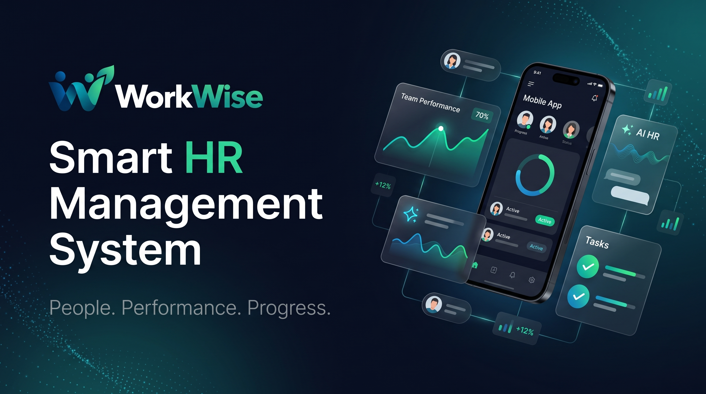
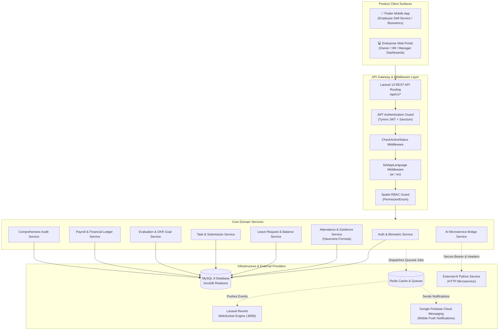
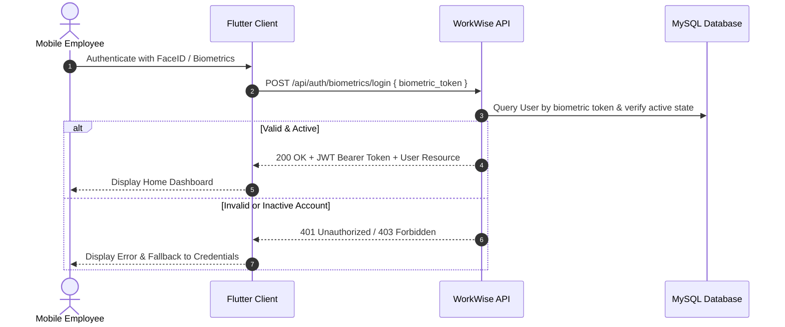
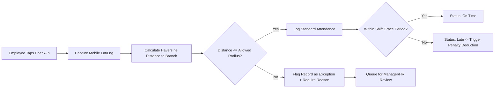

<div align="center">



# WorkWise — Smart HR Management System (HRMS) Backend API

**Enterprise-Grade, Multi-Tenant HR Ecosystem Engineered with Laravel 13, PHP 8.3, JWT Authentication & Geofenced Automation**

[](https://www.php.net/)
[](https://laravel.com/)
[](https://github.com/tymondesigns/jwt-auth)
[](https://spatie.be/docs/laravel-permission)
[](https://registry.scalar.com/@workwise/apis/hr-api-documentation@1.0.0?format=preview)
[](https://firebase.google.com/)
[](#license)

<br/>

[Explore Scalar API Documentation](https://registry.scalar.com/@workwise/apis/hr-api-documentation@1.0.0?format=preview) • [Explore SwaggerHub API Portal](https://app.swaggerhub.com/apis-docs/wisework-4e6/hr-api-documentation/1.0.0?view=uiDocs#/) • [Report Bug / Feature Request](https://github.com/Menna-Baligh/HRMS/issues)

</div>

---

## 📑 Table of Contents

- [Executive Summary](#-executive-summary)
- [System Architecture & Design Patterns](#-system-architecture--design-patterns)
- [Core Technology Stack](#-core-technology-stack)
- [Key Business Modules & Capabilities](#-key-business-modules--capabilities)
  - [1. Authentication & Biometric Identity](#1-authentication--biometric-identity)
  - [2. Geofenced Mobile Attendance Engine](#2-geofenced-mobile-attendance-engine)
  - [3. Leave Management & Entitlement Engine](#3-leave-management--entitlement-engine)
  - [4. Task Delegation & Review Lifecycle](#4-task-delegation--review-lifecycle)
  - [5. Performance Evaluations & OKR Goals](#5-performance-evaluations--okr-goals)
  - [6. Financial Management & Automated Payroll](#6-financial-management--automated-payroll)
  - [7. Enterprise AI Intelligence Bridge](#7-enterprise-ai-intelligence-bridge)
  - [8. Real-time Broadcasting & Push Notifications](#8-real-time-broadcasting--push-notifications)
  - [9. Comprehensive Audit Trail & Compliance](#9-comprehensive-audit-trail--compliance)
- [Role & Capability Matrix](#-role--capability-matrix)
- [Interactive API Documentation & Standards](#-interactive-api-documentation--standards)
- [Database Domain Entity Relationships](#-database-domain-entity-relationships)
- [Security, Privacy & Data Integrity](#-security-privacy--data-integrity)
- [Local Development Setup](#-local-development-setup)
- [Testing & Quality Assurance](#-testing--quality-assurance)
- [Deployment & Infrastructure](#-deployment--infrastructure)
- [Repository Structure](#-repository-structure)
- [Contributing & Code Standards](#-contributing--code-standards)
- [License & Acknowledgments](#-license--acknowledgments)

---

## 🌟 Executive Summary

**WorkWise** is a modern, high-performance Human Resource Management System (HRMS) backend built to power both a native **Flutter Mobile Application** for employees and an **Enterprise Web Portal** for HR administrators, line managers, and executive business owners.

Engineered on **Laravel 13** and **PHP 8.3**, WorkWise moves beyond legacy, bureaucratic HR systems. It unifies workforce operations into a single API surface: automated GPS-based geofenced attendance, multi-tiered leave approvals, milestone-driven task workflows, OKR/KPI performance appraisals, batch payroll processing with loan deductions, and AI-powered workforce analytics.

### Why WorkWise?
- **Zero Friction Mobile Self-Service**: Employees clock in using GPS coordinate verification and biometrics (Face ID / Fingerprint), submit leave requests, monitor goals, and receive instant push updates.
- **Enterprise Governance**: Built with fine-grained Spatie Role-Based Access Control (RBAC), immutable audit logging across sensitive operations, and multi-currency/multi-tier financial accounting.
- **Integrated AI Copilot**: Native gateway routing requests to specialized AI microservices for career coaching, automated performance review drafting, skill gap diagnoses, and corporate policy querying.
- **Real-Time Synergy**: Low-latency WebSocket broadcasting powered by Laravel Reverb coupled with asynchronous Firebase Cloud Messaging (FCM) background dispatchers.

---

## 🏗️ System Architecture & Design Patterns

WorkWise follows Clean Architecture and Domain-Driven Design principles within the Laravel ecosystem. The application cleanly decouples HTTP controllers from domain logic via dedicated **Services**, **DTOs**, **Aggregators**, **Custom Form Requests**, **API Resources**, and **Queued Event Listeners**.



### Architectural Tenets
1. **Separation of Concerns**: Controllers act strictly as request coordinators. Complex business rules (e.g. leave balance deductions, lateness calculations, payroll taxations) live within transactional Services.
2. **Standardized Serialization**: 100% of API endpoints utilize explicit `JsonResource` transformers to maintain an immutable contract with frontend and mobile clients.
3. **Optimistic Database Transactions**: Multi-model writes (such as creating leave requests with audit records, or finalizing whole-company payroll with loan updates) are wrapped in `DB::transaction()` closures to guarantee atomicity.
4. **Bilingual by Design**: Every system message, notification payload, and enum label supports seamless Arabic (`ar`) and English (`en`) localization out of the box.

---

## 💻 Core Technology Stack

| Layer / Component | Technology | Version | Purpose |
| :--- | :--- | :--- | :--- |
| **Runtime Engine** | [PHP](https://www.php.net/) | `^8.3` | Modern typed runtime leveraging match expressions, readonly properties, and JIT optimizations. |
| **Framework** | [Laravel](https://laravel.com/) | `^13.17` | Robust enterprise web framework handling routing, dependency injection, and ORM. |
| **Primary Database** | [MySQL](https://www.mysql.com/) | `^8.0` | Relational storage with strict foreign keys, indexes, and full-text search capabilities. |
| **API Authentication** | [tymon/jwt-auth](https://github.com/tymondesigns/jwt-auth) | `^2.1` | Stateless, cryptographically signed JSON Web Tokens for cross-platform clients. |
| **Biometric Auth** | Custom Engine | `Internal` | Cryptographic hardware device token exchange for instant face/fingerprint authentication. |
| **Authorization / RBAC** | [spatie/laravel-permission](https://spatie.be/docs/laravel-permission) | `^6.16` | Granular permission-based access control with native role inheritance. |
| **Realtime WebSockets**| [laravel/reverb](https://reverb.laravel.com/) | `^1.4` | First-party, event-driven WebSocket server running alongside the HTTP stack. |
| **Push Notifications** | [kreait/laravel-firebase](https://github.com/kreait/laravel-firebase) | `^5.9` | Asynchronous mobile notification pipeline supporting Google FCM v1 protocols. |
| **API Documentation** | [scalar/laravel](https://github.com/scalar/scalar) & [scribe](https://scribe.knuckles.wtf/) | `^1.0` / `^4.48` | Interactive OpenAPI 3.0 UI generation, scalar sandbox, and mock test harnesses. |
| **Document Generation**| [barryvdh/laravel-dompdf](https://github.com/barryvdh/laravel-dompdf) | `^3.1` | Automated PDF rendering for official employee payslips and corporate policy packets. |
| **Spreadsheet Engine** | [maatwebsite/excel](https://maatwebsite.nl/) | `^3.1` | High-throughput XLSX/CSV payroll imports and financial report exports. |
| **Testing Suite** | [Pest](https://pestphp.com/) & [PHPUnit](https://phpunit.de/) | `^3.7` / `^11.5` | Expressive feature and unit test automation running against in-memory SQLite and MySQL. |
| **Code Formatter** | [Laravel Pint](https://laravel.com/docs/pint) | `^1.21` | Opinionated PHP CS Fixer enforcing PSR-12 and Laravel architectural style guidelines. |

---

## ⚡ Key Business Modules & Capabilities

### 1. Authentication & Biometric Identity
WorkWise supports enterprise-grade identity flows for all four system roles (`Owner`, `HR`, `Manager`, `Employee`):
- **Stateless JWT Tokens**: Issues signed tokens containing custom claims (`sub`, `role`, `emp_id`). Includes token refresh, blacklisting, and explicit logout mechanisms.
- **Biometric Device Handshake**: Mobile users can toggle biometric authentication. The backend provisions a unique hardware-tied biometric key that allows one-tap face or fingerprint login without transmitting raw passwords.
- **OTP Password Recovery**: Direct password resets utilizing 6-digit cryptographic verification codes delivered to verified corporate email addresses.
- **Active State Validation**: `CheckActiveStatus` middleware intercepts every authenticated request, instantly rejecting terminated or suspended personnel.



---

### 2. Geofenced Mobile Attendance Engine
Designed for accurate, tamper-proof workforce tracking without biometric physical hardware terminals:
- **Haversine Geofencing**: The backend executes mathematical spherical distance calculations between the employee’s GPS coordinates and their assigned `CompanyLocation` branch.
- **Grace Periods & Lateness**: Automatically compares the arrival timestamp against the company’s official shift schedule (e.g. 15-minute grace window). Overdue check-ins are tagged as `Late`.
- **Exception Approvals**: If an employee clocks in outside the geofence (e.g. client site or field duty), the record is flagged as `is_exception = true`. Line managers and HR admins review exception logs with attached reasoning.
- **Automated Work Duration**: Check-outs calculate precision `worked_seconds` to feed directly into the payroll overtime and deduction engine.



---

### 3. Leave Management & Entitlement Engine
A flexible absence management lifecycle supporting customizable leave policies (Annual, Sick, Casual, Unpaid, Emergency):
- **Automated Balance Provisioning**: Every year, active employees are provisioned customized leave allocations based on policy tiers and tenure.
- **Collision & Overlap Protection**: The database rejects any leave application overlapping with existing `pending` or `approved` requests.
- **Hierarchical Approval Workflow**:
  - Employee submits request $\rightarrow$ Manager evaluates recommendation $\rightarrow$ HR approves/rejects with audit trail.
- **Dynamic Re-crediting**: Rejected or cancelled leaves automatically restore the employee's balance in real time.

---

### 4. Task Delegation & Review Lifecycle
Streamlines internal project execution between teams and supervisors:
- **Role Scoping**: Managers and HR assign priority-tagged tasks (`Urgent`, `High`, `Medium`, `Low`) to single or multiple team members with concrete deadlines.
- **Submission Evidence**: Employees submit deliverables containing markdown notes and uploaded binary files (PDFs, ZIPs, images) managed by the centralized `FileService`.
- **State Machine**:
  $$\text{Pending} \longrightarrow \text{In Progress} \longrightarrow \text{Pending Review} \longrightarrow \begin{cases} \text{Approved} \longrightarrow \text{Completed} \\ \text{Changes Requested} \\ \text{Rejected} \end{cases}$$

---

### 5. Performance Evaluations & OKR Goals
Replaces subjective reviews with measurable, data-backed performance metrics:
- **Periodic Appraisals**: Structured review cycles (`EvaluationPeriod`) created by HR Admins with defined scoring rubrics and weighted categories.
- **Goal Evidence Linkage**: Employees link active OKR goals (`Goal` model) to their self-evaluations as verifiable proof of target completion.
- **Performance Summary Aggregator**: `PerformanceSummaryService` aggregates attendance percentage, task completion velocity, and manager scores to generate objective employee ratings.

---

### 6. Financial Management & Automated Payroll
An all-in-one compensation engine that eliminates manual payroll spreadsheets:
- **Compensation Formula**:
  $$\text{Net Salary} = \max\Big(0, \; (\text{Basic Salary} + \sum \text{Approved Bonuses}) - (\sum \text{Queued Deductions} + \sum \text{Salary Advance Installments})\Big)$$
- **Salary Advances (Loans)**: Structured loan applications with custom monthly repayment schedules deducted automatically each billing cycle.
- **One-Click Batch Finalization**: HR finalizes monthly payrolls within a single atomic database transaction, transitions deductions to `deducted`, notifies all staff via FCM, and generates downloadable PDF payslips.

---

### 7. Enterprise AI Intelligence Bridge
WorkWise integrates with an external high-performance Python AI microservice, exposing seven cutting-edge endpoints while enforcing zero-trust data boundary controls:

| Feature / Endpoint | Target Role | Description |
| :--- | :--- | :--- |
| `POST /api/ai/career-coach` | All Employees | Personalized career coaching, skill recommendations, and professional development trajectories. |
| `POST /api/ai/performance-insight` | HR & Manager | Predictive performance insights, trend analyses, and burnout indicators based on attendance and task metrics. |
| `POST /api/ai/evaluation-draft` | HR & Manager | Automated generation of qualitative evaluation writeups tailored to rubric scores. |
| `POST /api/ai/skill-gap` | HR & Owner | Company-wide diagnostic detecting capability deficits across engineering, product, and sales teams. |
| `POST /api/ai/attention-signal` | HR & Owner | Early warning system detecting absenteeism, disengagement, and deadline slippages. |
| `POST /api/ai/team-insight` | Manager & HR | Department-level velocity, morale sentiment, and cross-functional capacity analyses. |
| `POST /api/ai/policy-assistant` | All Roles | Conversational assistant querying the company's indexed policies, HR guidelines, and employee handbook. |

> **Security & Header Isolation**: The gateway dynamically attaches `X-Caller-Employee-ID` and sanitized `X-Caller-Role` headers to microservice requests. Unauthorized employee requests for team insights are blocked at the gateway level before hitting the AI cluster.

---

### 8. Real-time Broadcasting & Push Notifications
- **Event-Driven Architecture**: Critical events (`LeaveRequestSubmitted`, `GoalCompleted`, `NotificationSentEvent`) dispatch queued background workers.
- **Private WebSocket Channels**: `notifications.{id}` channels secured with JWT guards stream instant updates to the web portal via **Laravel Reverb**.
- **Dual-Language Mobile Push**: **Google Firebase Cloud Messaging (FCM)** sends localized notification titles and bodies matching the recipient's chosen language (`ar` or `en`).

---

### 9. Comprehensive Audit Trail & Compliance
Every critical workforce modification is captured via the polymorphic `AuditService`:
- Tracks who performed the action (`actor_id`), what action occurred (`AuditAction`), which record was modified (`entity_type`, `entity_id`), and contextual JSON metadata.
- Captures leave approvals, task priority changes, evaluation completions, policy revisions, and AI queries.
- Exposes searchable, paginated audit logs with date-range and action-type filters reserved exclusively for Owners and HR Admins.

---

## 👥 Role & Capability Matrix

WorkWise strictly segregates permissions across four primary user personas using `spatie/laravel-permission` and `PermissionEnum`:

| Operational Domain | Executive Owner | HR Administrator | Department Manager | Regular Employee |
| :--- | :---: | :---: | :---: | :---: |
| **System Administration** | 👑 Full Control | 🛠️ Operational Admin | 👥 Team Scoped | 👤 Self Only |
| **Employee Directory** | Manage All & Salaries | Create, Edit, Salaries | View Team Only | View Coworkers |
| **Geofenced Attendance** | View Company-Wide | Manage & Audit Exceptions | Approve Team Exceptions | Mobile Clock-In/Out |
| **Leave Management** | Final Decision Audit | Final Approval & Balance Config | First-Line Approval | Submit & View Balance |
| **Task Delegation** | Oversee All Teams | Oversee & Assign | Create, Assign & Review | Execute & Submit |
| **Performance Reviews** | Executive Calibration | Create Periods & Manage | Score Direct Reports | Self-Review & Goals |
| **Payroll & Compensation**| Final Financial Approval| Batch Calculate & Finalize | Restricted (No Access) | View Personal Payslips|
| **Bonuses & Deductions** | Unlimited Authorization| Create & Authorize | Request Bonus for Team | View Own History |
| **Salary Advances / Loans**| Approve High Limits | Manage & Approve | Restricted | Apply for Advance |
| **Company Policies** | Publish & Deprecate | Draft & Manage Versions | Read Active | Read Active |
| **System Audit Logs** | Comprehensive Access | Full Audit Access | No Access | No Access |
| **AI Team Analytics** | Full Company Scope | Full Company Scope | Department Scoped | Blocked (Forbidden) |
| **AI Career Coach** | Accessible | Accessible | Accessible | Accessible |

---

## 📖 Interactive API Documentation & Standards

WorkWise delivers interactive, developer-ready API documentation following the **OpenAPI 3.0.3** standard.

### 🌐 Explore API Docs Online
- **Scalar Interactive Hub**: [https://registry.scalar.com/@workwise/apis/hr-api-documentation@1.0.0?format=preview](https://registry.scalar.com/@workwise/apis/hr-api-documentation@1.0.0?format=preview)
- **SwaggerHub Documentation**: [https://app.swaggerhub.com/apis-docs/wisework-4e6/hr-api-documentation/1.0.0?view=uiDocs#/](https://app.swaggerhub.com/apis-docs/wisework-4e6/hr-api-documentation/1.0.0?view=uiDocs#/)
- **Local OpenAPI Spec**: Located at `public/openapi.yaml` in this repository.

### 📐 Standardized Response Envelope
Every endpoint returns a consistent JSON payload orchestrated through `App\Helpers\ResponseHelper`:

#### Success Response (`200 OK`, `201 Created`):
```json
{
  "status": true,
  "message": "Operation completed successfully.",
  "data": {
    "id": 142,
    "employee_code": "EMP-2026-042",
    "name": "Sarah Jenkins",
    "job_title": "Senior Backend Architect",
    "status": "Active"
  }
}
```

#### Error Response (`400`, `401`, `403`, `422`, `500`):
```json
{
  "status": false,
  "message": "Validation failed.",
  "errors": {
    "start_date": [
      "The start date must be a date after or equal to today."
    ]
  }
}
```

### 🛣️ API Route Catalog Overview

<details>
<summary><b>Click to expand full Endpoint Route Mapping</b></summary>
<br/>

| Module | Method | URI Pattern | Protected | Required Roles / Permissions |
| :--- | :---: | :--- | :---: | :--- |
| **Auth** | `POST` | `/api/auth/register` | ❌ | Public |
| | `POST` | `/api/auth/login` | ❌ | Public |
| | `POST` | `/api/auth/biometrics/toggle` | ✅ | Any Authenticated User |
| | `POST` | `/api/auth/biometrics/login` | ❌ | Public (Device Key) |
| | `POST` | `/api/auth/forgot-password` | ❌ | Public |
| | `POST` | `/api/auth/reset-password` | ❌ | Public |
| | `POST` | `/api/auth/logout` | ✅ | Any Authenticated User |
| | `GET` | `/api/auth/profile` | ✅ | Any Authenticated User |
| **Attendance** | `POST` | `/api/attendance/check-in` | ✅ | `attendance.check_in` (Mobile) |
| | `POST` | `/api/attendance/check-out` | ✅ | `attendance.check_out` (Mobile) |
| | `GET` | `/api/attendance/today` | ✅ | `attendance.view_own` |
| | `GET` | `/api/attendance/history` | ✅ | `attendance.view_own` |
| | `GET` | `/api/attendance/manager/team-daily` | ✅ | `attendance.view_team` (Manager) |
| | `GET` | `/api/attendance/hr/daily-records` | ✅ | `attendance.view_all` (HR/Owner) |
| | `POST` | `/api/attendance/exceptions/{id}/resolve`| ✅ | `attendance.approve_exceptions` |
| **Leaves** | `POST` | `/api/leave-requests` | ✅ | `leaves.create` |
| | `GET` | `/api/leave-requests/my-requests` | ✅ | `leaves.view_own` |
| | `POST` | `/api/leave-requests/{id}/approve` | ✅ | `leaves.approve` (Manager/HR) |
| | `POST` | `/api/leave-requests/{id}/reject` | ✅ | `leaves.reject` (Manager/HR) |
| | `GET` | `/api/leave-balances/my-balances` | ✅ | `leaves.view_own` |
| **Tasks** | `POST` | `/api/tasks` | ✅ | `tasks.create` (Manager/HR) |
| | `GET` | `/api/tasks/my-tasks` | ✅ | `tasks.view_own` |
| | `POST` | `/api/tasks/{id}/submissions` | ✅ | `tasks.submit` |
| | `POST` | `/api/tasks/submissions/{id}/review` | ✅ | `tasks.review` (Manager/HR) |
| **Performance** | `POST` | `/api/goals` | ✅ | `goals.create` |
| | `PUT` | `/api/goals/{id}/complete` | ✅ | `goals.update` |
| | `POST` | `/api/evaluations/draft` | ✅ | `evaluations.draft` (Manager/HR) |
| | `POST` | `/api/evaluations/submit` | ✅ | `evaluations.submit` (Manager/HR) |
| | `GET` | `/api/evaluations/summary` | ✅ | `evaluations.view` |
| **Payroll** | `GET` | `/api/financial/payroll` | ✅ | `financial.payroll.view` (HR/Owner) |
| | `POST` | `/api/financial/payroll/finalize` | ✅ | `financial.payroll.finalize` (HR) |
| | `GET` | `/api/financial/payroll/my-payslips` | ✅ | Authenticated Employee |
| | `POST` | `/api/financial/salary-advances` | ✅ | `financial.advances.request` |
| | `POST` | `/api/financial/bonuses` | ✅ | `financial.bonuses.create` (HR/Owner) |
| **AI Services** | `POST` | `/api/ai/career-coach` | ✅ | Authenticated User |
| | `POST` | `/api/ai/performance-insight` | ✅ | `ai.performance.insight` |
| | `POST` | `/api/ai/evaluation-draft` | ✅ | `ai.evaluation.draft` |
| | `POST` | `/api/ai/skill-gap` | ✅ | `ai.skill_gap.view` |
| | `POST` | `/api/ai/team-insight` | ✅ | `ai.team.insight` |
| | `POST` | `/api/ai/policy-assistant` | ✅ | Authenticated User |
| **Audits** | `GET` | `/api/audits` | ✅ | `audits.view` (Owner/HR) |

</details>

---

## 🗄️ Database Domain Entity Relationships

The relational model is designed in Third Normal Form (3NF) with strict cascade behaviors and optimized composite indexes for high-throughput queries:

```mermaid
erDiagram
    users ||--o{ attendances : "clocks in"
    users ||--o{ leave_requests : "applies for"
    users ||--o{ leave_balances : "holds entitlement"
    users ||--o{ task_assignments : "assigned to"
    users ||--o{ submissions : "submits deliverables"
    users ||--o{ goals : "owns OKRs"
    users ||--o{ evaluations : "evaluated in"
    users ||--o{ payrolls : "receives compensation"
    users ||--o{ salary_advances : "borrows"
    users ||--o{ audits : "triggers as actor"
    users }|--|| departments : "belongs to"
    users }|--|| company_locations : "assigned to branch"
    users ||--o{ users : "supervises as manager"

    departments ||--o{ users : "staffed by"
    company_locations ||--o{ attendances : "verified against geofence"

    tasks ||--o{ task_assignments : "distributes"
    tasks ||--o{ submissions : "receives"
    submissions ||--o{ submission_reviews : "reviewed in"

    leave_types ||--o{ leave_requests : "categorizes"
    leave_types ||--o{ leave_balances : "allocates"
    leave_requests ||--o{ leave_decisions : "approval history"

    evaluation_periods ||--o{ evaluations : "conducted within"
    evaluations ||--o{ evaluation_scores : "scored by rubric"
    evaluations ||--o{ evaluation_evidence : "substantiated by goals"

    payrolls ||--o{ deductions : "deducts queued amounts"
    payrolls ||--o{ bonuses : "credits approved amounts"
```



---

## 🛡️ Security, Privacy & Data Integrity

- **Cryptographic Security**: Sensitive user credentials hashed using standard Bcrypt (`BCRYPT_ROUNDS=12`).
- **Authorization Guardrails**: Direct Report validation prevents unauthorized managers from reviewing or scoring employees outside their explicit managerial tree.
- **Data Scoping & Privacy**: Salary and compensation fields are automatically excluded from JSON responses unless the requesting user possesses `isHrOrAbove()` authorization or is accessing their own authenticated profile.
- **SQL Injection & XSS Immunity**: 100% of queries leverage Eloquent ORM or parameterized PDO bindings; input strings are sanitized and validated through dedicated FormRequests.
- **Audited State Changes**: Sensitive actions (e.g. status changes, evaluations, policy deactivations) generate non-repudiable audit logs containing actor ID, target entity, and timestamp.

---

## 🚀 Local Development Setup

Follow these instructions to configure and run the WorkWise API locally on your workstation.

### Prerequisites
- **PHP**: `8.3.0` or higher with extensions (`pdo_mysql`, `mbstring`, `openssl`, `bcmath`, `curl`, `gd`, `zip`)
- **Composer**: `2.6+`
- **MySQL**: `8.0+`
- **Node.js**: `20.x+` (for asset bundling)
- **Firebase Project Account**: (For testing mobile push notifications)

### Step-by-Step Installation

```bash
# 1. Clone the repository
git clone https://github.com/Menna-Baligh/HRMS.git workwise-backend
cd workwise-backend

# 2. Install PHP backend dependencies
composer install

# 3. Provision environment configuration
cp .env.example .env

# 4. Generate application encryption key
php artisan key:generate

# 5. Generate cryptographic JWT Secret Key
php artisan jwt:secret

# 6. Configure Database in .env:
# DB_CONNECTION=mysql
# DB_HOST=127.0.0.1
# DB_PORT=3306
# DB_DATABASE=workwise_hrms
# DB_USERNAME=your_username
# DB_PASSWORD=your_password

# 7. Execute database migrations and seed permissions & test accounts
php artisan migrate:fresh --seed

# 8. Create storage symlink for file uploads
php artisan storage:link

# 9. Start the local development server
php artisan serve --port=8000
```

### Running Asynchronous Workers & WebSockets
In separate terminal tabs, launch the queue worker and Reverb WebSocket server:

```bash
# Process asynchronous jobs (Emails, Push Notifications, Event Logs)
php artisan queue:work --tries=3 --timeout=90

# Start Laravel Reverb WebSocket Server (Port 8090)
php artisan reverb:start --host=0.0.0.0 --port=8090
```

---

## 🧪 Testing & Quality Assurance

WorkWise features a suite of feature and unit tests built with **Pest** and **PHPUnit**, covering authorization boundaries, leave calculations, and attendance workflows.

```bash
# Run all test suites
php artisan test

# Run tests with coverage report
php artisan test --coverage

# Run specific feature tests
php artisan test tests/Feature/LeaveWorkflowTest.php
php artisan test tests/Feature/LeaveBalanceTest.php
php artisan test tests/Feature/AuthTest.php

# Execute Laravel Pint to inspect code style
vendor/bin/pint --test

# Automatically fix code formatting
vendor/bin/pint
```

---

## 🚢 Deployment & Infrastructure

WorkWise is configured for cloud deployment across containerized environments, VPS droplets, and PaaS platforms like Railway, Fly.io, or AWS ECS.

### Production Procfile
The repository includes a battle-tested `Procfile` for container runtimes:
```procfile
web: mkdir -p storage/app && echo "$FIREBASE_CREDENTIALS" | base64 -d > storage/app/firebase-credentials.json && php artisan migrate --force && php artisan db:seed --class=RolesAndPermissionsSeeder --force && php artisan permission:cache-reset && php artisan config:cache && php artisan route:cache && php artisan view:cache && (php artisan reverb:start --host=0.0.0.0 --port=8090 &) && (php artisan queue:work --tries=3 --timeout=0 &) && php artisan serve --host=0.0.0.0 --port=$PORT
release: php artisan storage:link --force
```

### Nixpacks Configuration
For platforms utilizing [Nixpacks](https://nixpacks.com/) (e.g. Railway), `nixpacks.toml` guarantees native compilation of PHP 8.3 extensions:
```toml
[phases.setup]
nixPkgs = ['php83', 'php83Packages.composer', 'php83Extensions.pcntl', 'php83Extensions.zip', 'php83Extensions.gd', 'php83Extensions.redis', 'php83Extensions.pdo_mysql']

[phases.build]
cmds = ['composer install --ignore-platform-req=ext-redis --no-dev --optimize-autoloader']

[start]
cmd = 'php artisan schedule:work'
```

---

## 📂 Repository Structure

```text
├── app/
│   ├── DTOs/                   # Data Transfer Objects for strict service typing
│   ├── Enums/                  # Backed enums (UserRole, PermissionEnum, LeaveStatus, etc.)
│   ├── Events/                 # Real-time WebSocket broadcasting events
│   ├── Exceptions/             # Custom domain exception handlers
│   ├── Helpers/                # Universal helpers (ResponseHelper, DistanceCalculator)
│   ├── Http/
│   │   ├── Controllers/Api/    # Thin REST API Controllers grouped by domain
│   │   ├── Middleware/         # Custom pipeline (CheckActiveStatus, SetAppLanguage)
│   │   ├── Requests/           # Validated FormRequest specifications
│   │   └── Resources/          # JsonResource transformers for API responses
│   ├── Jobs/                   # Queued asynchronous workers (FCM notification dispatch)
│   ├── Models/                 # Eloquent entities with relationships & query scopes
│   ├── Notifications/          # Multi-channel notification classes
│   └── Services/               # Core business logic layer
│       ├── Aggregators/        # Cross-module metric aggregation services
│       ├── Auth/               # Biometric & JWT token services
│       ├── LeaveBalances/      # Dynamic entitlement calculation
│       ├── LeaveRequests/      # Multi-stage approval workflow
│       └── ...                 # Geofence, Payroll, Audit, AI Bridge Services
├── config/                     # Application, JWT, Reverb, and Service configurations
├── database/
│   ├── factories/              # Model data factories for testing
│   ├── migrations/             # Schema definitions and database indexes
│   └── seeders/                # Default roles, permissions, and demo company seeders
├── public/
│   └── openapi.yaml            # Complete OpenAPI 3.0.3 specification
├── routes/
│   ├── api.php                 # Core REST API route endpoints
│   ├── channels.php            # Authorized WebSocket private channel definitions
│   └── console.php             # Scheduled cron jobs (attendance sweeps, loan balance deductions)
├── tests/
│   ├── Feature/                # End-to-end API feature tests
│   └── Unit/                   # Isolated service and calculation unit tests
├── nixpacks.toml               # Cloud container build specification
├── Procfile                    # Multi-process production entrypoint
└── WorkWise_GitHub_banner.jpg  # Repository visual cover asset
```

---

## 🤝 Contributing & Code Standards

We welcome engineering contributions to WorkWise! To maintain software quality:

1. **Fork the Project** & create your feature branch:
   ```bash
   git checkout -b feature/AmazingFeature
   ```
2. **Follow PSR-12 & Clean Architecture**: Run `vendor/bin/pint` prior to committing.
3. **Write Unit/Feature Tests**: Add relevant test cases in `tests/Feature/` for any new endpoints or business logic changes.
4. **Update API Documentation**: Ensure any changed parameters or payloads are mirrored in `public/openapi.yaml`.
5. **Open a Pull Request**: Provide a clear explanation of the architectural change and link relevant issues.

---

## 📄 License & Acknowledgments

This project is developed and maintained by **[Menna Baligh](https://github.com/Menna-Baligh)** and the WorkWise Engineering Team.

- Built with [Laravel](https://laravel.com/)
- Interactive documentation powered by [Scalar](https://scalar.com/) & [SwaggerHub](https://swagger.io/tools/swaggerhub/)
- Mobile Push Notifications powered by [Google Firebase](https://firebase.google.com/)

<div align="center">
  <sub>WorkWise Smart HRMS Backend • Transforming Enterprise Workforce Management</sub>
</div>
